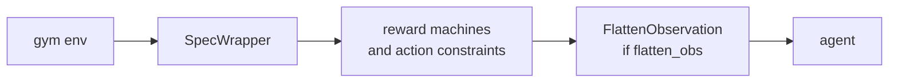

# Concepts

RLRom sits between the environment and the agent. Every step, the environment's
observations and actions are turned into **signals**, the monitor evaluates the
**formulas** over them, and the resulting **robustness values** are what the rest
of the system consumes.

```
         ┌─────────────┐   obs, action, reward
         │ environment │───────────────┐
         └─────────────┘               ▼
                ▲              ┌──────────────┐
                │              │  signals     │  action_names, obs_names,
                │              │  (expressions)│  aux_sig_names, env_reward
                │              └──────┬───────┘
                │                     ▼
                │              ┌──────────────┐
        action  │              │  STL monitor │  .stl formulas + params
      (possibly │              │  (stlrom)    │
       shielded)│              └──────┬───────┘
                │                     ▼
                │              ┌──────────────┐
                │              │  robustness  │──► labels ──► reward machine
                │              └──────┬───────┘                   │
                │                     │                           │
                │              ┌──────▼───────────────────────────▼──┐
                └──────────────│ observation / reward / constraints  │
                               └──────────────────────────────────────┘
```

## Signal

A signal is a named time series the monitor can reason about. RLRom builds them
from the environment step:

| Kind | Config key | Example |
|---|---|---|
| Action | `cfg_specs.action_names` | `push: "action"` |
| Observation | `cfg_specs.obs_names` | `x: "obs[0]"` |
| Anything else | `cfg_specs.aux_sig_names` | `speed: "obs[3] * 20"` |
| Environment reward | always sampled | signal name `env_reward` |

The right-hand side is a Python expression evaluated at every step, with `obs`
and `action` in scope. It is user code: any expression that reads them is valid.

## Formula and robustness

Formulas are written in the STL dialect of [`stlrom`](../guide/specifications.md)
and stored in a `.stl` file. A monitor evaluates a formula over the signals
recorded so far and returns a **robustness** value: positive when the formula
holds, negative when it is violated, and larger in absolute value the further the
trace is from the boundary. Robustness is a real number, not a boolean, which is
why it is useful as a reward or as an observation.

A formula is *monitorable per step* when it only looks at the past (`x[t] < 0`)
or at a bounded past window (`alw_[0,100] …`). Formulas that look into the future
(`ev_[0,400] …`) are evaluated over the whole episode instead — in RLRom these go
under `eval_formulas`, while per-step formulas go under `monitor_formulas`.

## Label

Each monitor formula also produces a label: true when the formula's monitored
lower robustness bound is positive at that step. Labels are the vocabulary of
[reward machines](../guide/reward-machines.md): a transition fires when its condition
label is true.

## The wrapper pipeline

`wrap_env_specs` builds the stack from the config, in this order:



There is one wrapper class, [`SpecWrapper`](../api/wrappers.md), driven entirely
by `cfg_specs`. If a config has no `cfg_specs`, the environment is used raw and
`rlr test` only reports the environment's own metrics.

## `model_use_specs`

One top-level flag records how the agent was trained:

- `model_use_specs: true` — the policy saw the wrapped observations and rewards;
  testing reproduces the same wrapper.
- `model_use_specs: false` — the policy was trained on the raw environment; the
  wrapper is still built for monitoring and plotting, and the policy sees
  `last_obs['unwrapped']`.

Getting this wrong loads the right weights into the wrong observation layout,
which usually shows up as an agent that behaves randomly.

## How a configuration is organised

| Section | Purpose |
|---|---|
| top-level keys | `env_id`, `env_name`, `model_name`, `model_path`, `model_use_specs`, `import_module` |
| `cfg_env` | arguments forwarded to `gym.make` |
| `cfg_specs` | signals, formulas, reward machines, constraints |
| `cfg_train` | algorithm, hyper-parameters, budgets, evaluation during training |
| `cfg_test` | episodes, horizon, seeds, rendering, plots |

Any value ending in `.yml` is replaced by that file's content when the config is
loaded, and any value ending in `.stl` by that file's text. The three
`rlr` overrides — `--cfg-specs`, `--cfg-train`, `--cfg-test` — replace one
section wholesale. See the [configuration reference](../guide/configuration.md).
